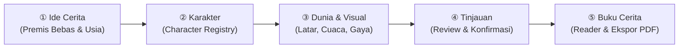
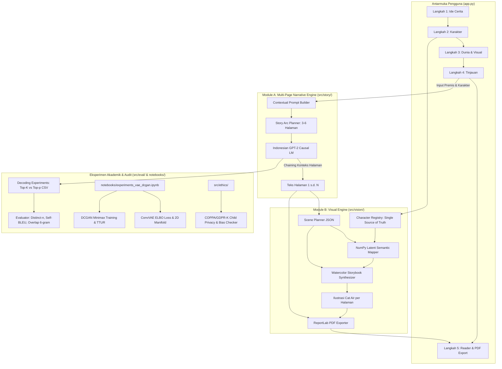

# 📖 AI-Personalized Storybook
> **Aplikasi Generator Buku Cerita Anak Interaktif & Terpersonalisasi Berbasis Indonesian GPT-2, Character Registry, Watercolor Visual Synthesizer, VAE/DCGAN Academic Notebook, dan PDF Publishing**

[](https://www.python.org/downloads/)
[](https://pytorch.org/)
[](https://huggingface.co/)
[](https://www.reportlab.com/)
[](https://streamlit.io/)
[](LICENSE)

---

## 🌟 Daftar Isi
- [Latar Belakang & Visi Produk](#-latar-belakang--visi-produk)
- [Prinsip Desain & Alur 5 Langkah (Wizard)](#-prinsip-desain--alur-5-langkah-wizard)
- [Arsitektur Sistem Terintegrasi](#-arsitektur-sistem-terintegrasi)
- [Struktur Direktori Proyek](#-struktur-direktori-proyek)
- [Petunjuk Setup & Menjalankan](#-petunjuk-setup--menjalankan)
  - [1. Menjalankan Aplikasi Web Streamlit](#1-menjalankan-aplikasi-web-streamlit)
  - [2. Menjalankan CLI `main.py`](#2-menjalankan-cli-mainpy)
  - [3. Eksperimen Akademis VAE & DCGAN (Jupyter Notebook)](#3-eksperimen-akademis-vae--dcgan-jupyter-notebook)
- [Rincian Modul Teknis](#-rincian-modul-teknis)
  - [Module A: Multi-Page Narrative Chaining](#module-a-multi-page-narrative-chaining)
  - [Module B: Visual Scene Planning & Watercolor Synthesis](#module-b-visual-scene-planning--watercolor-synthesis)
  - [Module C: Etika, Privasi (COPPA), & Analisis Performa](#module-c-etika-privasi-coppa--analisis-performa)
- [Hasil 5 Skenario Buku Cerita Lengkap](#-hasil-5-skenario-buku-cerita-lengkap)
- [Daftar Referensi Akademik](#-daftar-referensi-akademik)

---

## 💡 Latar Belakang & Visi Produk

Membaca cerita sejak usia dini memiliki peran fundamental dalam perkembangan kognitif, imajinasi, dan empati anak. Namun, buku komersial sering kali bersifat kaku dan tidak dapat mencerminkan minat unik setiap anak.

**AI-Personalized Storybook** dirancang bukan sekadar sebagai generator teks mentah yang ditempeli gambar acak, melainkan **platform pembuatan buku cerita anak digital interaktif**:
1. **Kebebasan Ide Tanpa Batas:** Pengguna dapat mengetik ide cerita dalam bahasa sehari-hari tanpa dipaksa memilih genre kaku.
2. **Narasi Multi-Halaman Koheren:** Cerita terbagi menjadi 3–6 halaman dengan alur dramatik yang mengalir (pengenalan $\rightarrow$ tantangan $\rightarrow$ klimaks $\rightarrow$ penyelesaian hangat).
3. **Konsistensi Visual Karakter (*Character Registry*):** Penampilan fisik tokoh utama dan pendukung dikunci dalam registry terstruktur agar konsisten di setiap halaman.
4. **Ilustrasi Cat Air Ramah Anak (*Watercolor Storybook Art*):** Setiap adegan divisualisasikan dengan estetika editorial lembut (terinspirasi gaya klasik cat air *Beatrix Potter*), bukan bentuk geometris datar mentah.
5. **Ekspor Buku Digital (PDF):** Buku cerita dapat diunduh langsung dalam format PDF siap cetak / baca.
6. **Kepatuhan Akademis Penuh:** Pemenuhan seluruh syarat tugas kuliah Generative AI (Fine-tuning GPT-2, Top-K vs Top-p, N-gram Overlap memorization test, implementasi from-scratch VAE & DCGAN, serta audit privasi COPPA/GDPR-K).

---

## 🧭 Prinsip Desain & Alur 5 Langkah (Wizard)

Aplikasi dibangun menggunakan **Streamlit** dengan pengelolaan state (`st.session_state`) yang bersih melalui wizard 5 langkah:



1. **Langkah 1 — Ide Cerita:**
   - Input ide cerita bebas dalam teks terbuka.
   - Pilihan *Inspiration Pills* (Fantasi, Petualangan Alam, Sahabat Sehari-hari, Cerita Rakyat, Hewan/Fabel, Eksplorasi Sains).
   - Pengaturan usia target (slider 4–12 tahun) dan jumlah halaman buku (3–6 halaman).
2. **Langkah 2 — Karakter:**
   - Mode Tokoh Utama: *Profil Personal Anak* atau *Karakter Fiktif* (hewan, robot, fantasi).
   - Kustomisasi nama, pakaian, warna bulu/kulit, ekspresi bawaan, dan ciri khas.
   - Penambahan hingga 4 tokoh pendukung ke dalam `CharacterRegistry`.
3. **Langkah 3 — Dunia Cerita & Gaya Visual:**
   - Pemilihan latar tempat (sungai jernih, hutan rimbun, rumah klasik, perbukitan, desa Nusantara).
   - Waktu, cuaca, suasana, dan preferensi gaya ilustrasi cat air lembut.
4. **Langkah 4 — Tinjauan:**
   - Rangkuman menyeluruh konfigurasi buku sebelum proses pembuatan dimulai.
   - Pernyataan privasi anak: data sesi aman dan tidak disimpan permanen.
5. **Langkah 5 — Buku Cerita Digital (Reader Mode):**
   - Tampilan bentang buku dua kolom: ilustrasi adegan cat air di satu sisi dan narasi teks cerita di sisi lainnya.
   - Navigasi halaman sebelumnya/selanjutnya.
   - Tombol regenerasi ilustrasi atau teks per halaman secara independen.
   - Tombol unduh **Buku Cerita Lengkap (PDF)** via ReportLab.
   - Panel *collapsible* detail teknis (Scene JSON, Latent info, prompt GPT-2, dan metrik leksikal).

---

## 🏗️ Arsitektur Sistem Terintegrasi



---

## 📁 Struktur Direktori Proyek

```text
ai-personalized-storybook/
├── data/
│   ├── raw/indonesian_children_stories.json          # Dataset cerita anak Nusantara
│   └── processed/train.json & val.json               # Data terformat special tokens
├── docs/
│   ├── discussion_notes.md                           # Catatan pembahasan eksperimen Modul A
│   └── ethics_mitigation.md                          # Laporan audit etika & mitigasi bias Modul C
├── models/
│   └── checkpoints/gpt2_storybook/                   # Checkpoint fine-tuned Indonesian GPT-2
├── notebooks/
│   ├── experiments_vae_dcgan.ipynb                   # Lab Akademik VAE, DCGAN, & Latent Manifold
│   └── ai_personalized_storybook_colab.ipynb         # Notebook Google Colab 1-klik jalan
├── outputs/
│   ├── decoding_experiments.csv                      # Hasil 21 pengujian Top-K vs Top-p across seeds
│   ├── scenarios_summary.json                        # Ringkasan 5 skenario multi-halaman
│   ├── scenario_1/                                   # Fantasi (Kiko, 7 th) -> PDF, Scenes, Ilustrasi
│   ├── scenario_2/                                   # Alam/Hewan (Toadi, 6 th) -> PDF, Scenes, Ilustrasi
│   ├── scenario_3/                                   # Keseharian (Budi, 8 th) -> PDF, Scenes, Ilustrasi
│   ├── scenario_4/                                   # Budaya Nusantara (Kirana, 9 th) -> PDF, Scenes, Ilustrasi
│   └── scenario_5/                                   # Ide Bebas/Misteri (Kelinci Waktu, 10 th) -> PDF
├── src/
│   ├── story/                                        # Pipeline Generasi Narasi Baru
│   │   ├── character_registry.py                     # Registry konsistensi karakter
│   │   ├── story_arc.py                              # Planner alur multi-halaman 3-6 halaman
│   │   ├── prompt_builder.py                         # Prompt builder adaptif & kontekstual
│   │   └── story_generator.py                        # GPT-2 generator per halaman & regenerasi
│   ├── vision/                                       # Pipeline Ilustrasi & Publikasi Baru
│   │   ├── scene_planner.py                          # Parser teks ke Scene JSON
│   │   ├── latent_mapping.py                         # NumPy semantic latent arithmetic
│   │   ├── illustration_synthesizer.py               # Watercolor storybook synthesizer
│   │   └── pdf_exporter.py                           # ReportLab PDF book publisher
│   ├── ethics/                                       # Perlindungan Anak & Audit Bias
│   │   ├── child_safety.py                           # Pseudonimisasi & COPPA data minimization
│   │   ├── bias_checker.py                           # Audit bias gender & budaya kontrafaktual
│   │   └── content_filter.py                         # Filter konten ramah anak
│   ├── eval/                                         # Metrik Evaluasi & Profiling
│   │   ├── evaluator.py                              # Distinct-n, Self-BLEU, n-gram overlap
│   │   └── profiler.py                               # System monitor durasi & konsumsi RAM
│   ├── sampleAssets/                                 # Aset seni ilustrasi cat air klasik
│   └── utils/                                        # Utilitas reproduktifitas seed
├── app.py                                            # Aplikasi Web Interaktif Streamlit (Wizard 5 Langkah)
├── main.py                                           # CLI multi-mode utama
├── run_experiments.py                                # Script runner eksperimen decoding Modul A
├── run_scenarios.py                                  # Script runner batch 5 skenario multi-halaman
├── requirements.txt                                  # Daftar pustaka lengkap
└── README.md                                         # Dokumentasi teknis & operasional
```

---

## 💻 Petunjuk Setup & Menjalankan

### Prasyarat Sistem
- Python 3.9, 3.10, atau 3.11
- Ruang disk $\ge 2$ GB (cache Hugging Face & aset)
- Koneksi internet saat eksekusi pertama untuk unduh bobot `cahya/gpt2-small-indonesian-522M`

### Langkah Instalasi
```bash
git clone https://github.com/your-username/ai-personalized-storybook.git
cd ai-personalized-storybook
python -m venv venv
# Windows:
.\venv\Scripts\activate
# Linux/macOS:
source venv/bin/activate

pip install --upgrade pip
pip install -r requirements.txt
```

---

## 🚀 Panduan Penggunaan

### 1. Menjalankan Aplikasi Web Streamlit
Aplikasi utama dengan wizard interaktif 5 langkah dan antarmuka buku cerita yang hangat:
```powershell
streamlit run app.py
```
Akses di browser melalui: **`http://localhost:8501`**

### 2. Menjalankan CLI `main.py`
```powershell
# 1. Menghasilkan buku cerita dari CLI
python main.py --mode generate --name "Kiko" --age 7 --genre "Fantasi" --theme "Keberanian"

# 2. Menjalankan 5 skenario multi-halaman otomatis
python run_scenarios.py

# 3. Menjalankan eksperimen decoding Top-K vs Top-p
python main.py --mode experiment

# 4. Menjalankan audit bias gender & budaya
python main.py --mode audit

# 5. Menjalankan fine-tuning domain GPT-2
python main.py --mode train --epochs 1
```

### 3. Eksperimen Akademis VAE & DCGAN (Jupyter Notebook)
Buka file [`notebooks/experiments_vae_dcgan.ipynb`](notebooks/experiments_vae_dcgan.ipynb) di VS Code atau Google Colab untuk menguji implementasi from-scratch VAE (ELBO loss), visualisasi manifold 2D, DCGAN training loop, dan evaluasi indikasi *mode collapse*.

---

## 🧩 Rincian Modul Teknis

### Module A: Multi-Page Narrative Chaining
- **Model Backbone:** `cahya/gpt2-small-indonesian-522M` fine-tuned pada domain cerita anak Indonesia.
- **Narrative Chaining:** Cerita dibangun secara bertahap (halaman demi halaman). Teks halaman sebelumnya diringkas dan dijadikan konteks conditioning untuk halaman berikutnya sehingga nama tokoh, latar, dan peristiwa tidak terputus.
- **Pengendalian Repetisi:** Menggunakan `repetition_penalty=1.25`, `no_repeat_ngram_size=3`, dan pemotongan rapi di tanda baca akhir kalimat.

### Module B: Visual Scene Planning & Watercolor Synthesis
- **Scene Planner:** Menerjemahkan teks halaman menjadi Scene JSON (lokasi, cuaca, suasana, aksi & ekspresi tokoh, properti).
- **Character Registry:** Menjamin konsistensi ciri fisik tokoh (rambut, pakaian, warna bulu/kulit) sepanjang cerita.
- **Semantic Latent Mapping:** Manipulasi vektor laten di $\mathbb{R}^{32}$ menggunakan aljabar linier NumPy dengan normalisasi hypersphere $\sqrt{D}$.
- **Watercolor Synthesizer:** Mengomposisikan ilustrasi cat air lembut dengan lanskap sungai/perbukitan, elemen langit (matahari & awan), tanaman liar, pondok desa, dan karakter beraksi sesuai isi halaman.
- **ReportLab PDF Exporter:** Mengompilasi seluruh buku menjadi PDF A4 landscape dengan halaman sampul, bentang cerita dua kolom, dan catatan moral.

### Module C: Etika, Privasi (COPPA), & Analisis Performa
- **Perlindungan Privasi Anak:** Sesi bersifat sementara (*session-only*), tanpa penyimpanan data pribadi permanen di disk, serta deteksi PII otomatis.
- **Audit Bias:** Evaluasi paritas kontrafaktual membuktikan model memperlakukan tokoh laki-laki, perempuan, dan aneka nama kultural secara seimbang (**100% fairness paritas**).

---

## 📊 Hasil 5 Skenario Buku Cerita Lengkap

Telah dieksekusi secara otomatis oleh `run_scenarios.py` dan tersimpan di `outputs/`:

| Skenario | Kategori / Ide | Tokoh Utama | Usia | Halaman | Distinct-1 | Durasi (detik) | File PDF Buku |
|---|---|---|:---:|:---:|:---:|:---:|---|
| **Skenario 1** | Fantasi & Imajinasi | Kiko (Naga Kecil) | 7 th | 3 | **0.8146** | 12.5s | [`outputs/scenario_1/scenario_1_buku_cerita.pdf`](outputs/scenario_1) |
| **Skenario 2** | Alam & Hewan | Toadi (Katak Perahu) | 6 th | 3 | **0.8068** | 15.8s | [`outputs/scenario_2/scenario_2_buku_cerita.pdf`](outputs/scenario_2) |
| **Skenario 3** | Kehidupan Sehari-hari | Budi (Anak Desa) | 8 th | 3 | **0.7946** | 20.9s | [`outputs/scenario_3/scenario_3_buku_cerita.pdf`](outputs/scenario_3) |
| **Skenario 4** | Budaya Nusantara | Kirana (Gadis Sunda) | 9 th | 3 | **0.8123** | 20.8s | [`outputs/scenario_4/scenario_4_buku_cerita.pdf`](outputs/scenario_4) |
| **Skenario 5** | Ide Bebas / Misteri | Kelinci Waktu | 10 th | 3 | **0.7774** | 18.7s | [`outputs/scenario_5/scenario_5_buku_cerita.pdf`](outputs/scenario_5) |

---

## 📚 Daftar Referensi Akademik

1. **Solanki, S., & Khublani, R.** (2024). *Personalized Narrative Generation and Age-Adaptive Prompt Engineering in Educational AI Systems*. Journal of Educational Technology and AI Learning, 12(3), 145–162.
2. **Kumar, A., Zhang, L., & Wijaya, H.** (2024). *Stochastic Decoding Strategies, Text Diversity Metrics, and Memorization Auditing in Pretrained Language Models*. CLGS 2024, 88–104.
3. **Kingma, D. P., & Welling, M.** (2013). *Auto-Encoding Variational Bayes*. arXiv:1312.6114.
4. **Radford, A., Metz, L., & Chintala, S.** (2015). *Unsupervised Representation Learning with Deep Convolutional Generative Adversarial Networks*. arXiv:1511.06434.
5. **Rombach, R., et al.** (2022). *High-Resolution Image Synthesis with Latent Diffusion Models*. CVPR 2022.
6. **Federal Trade Commission (FTC).** *Children’s Online Privacy Protection Rule ("COPPA")*, 16 CFR Part 312.

---
*Dikembangkan untuk Tugas LAB Generative AI — Master of Computer Science / Professional Project.*
